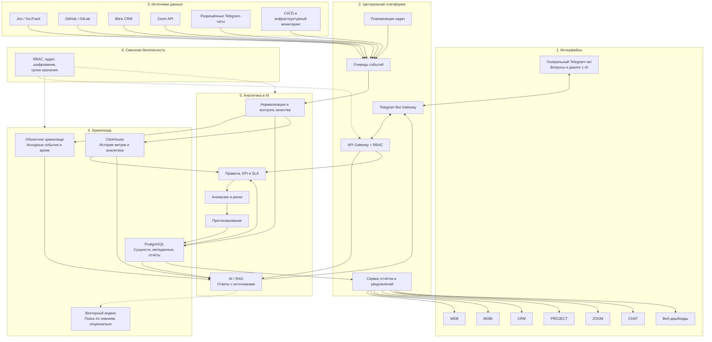

# Проект AI-корпоративной инфраструктуры мониторинга IT-департамента

## 1. Цель проекта

Создать корпоративную AI-платформу мониторинга IT-департамента, которая собирает данные из рабочих систем, проверяет и нормализует их, хранит историю, рассчитывает метрики, выявляет риски и предоставляет результаты через Telegram и веб-дашборды.

Ключевой принцип: **Telegram — интерфейс взаимодействия и публикации отчётов, а не основное хранилище данных**. Все исходные события, результаты аналитики и версии отчётов сохраняются в управляемой серверной инфраструктуре.

Система должна поддерживать долгосрочную аналитику и давать AI-ассистенту возможность отвечать на вопросы по накопленным данным с указанием источников, периода и ограничений анализа.

## 2. Логическая архитектура

## 3. Организация Telegram

Рекомендуется разделить интерактивное общение и публикацию отчётов.

### 3.1. Генеральный чат — AI Control Room

Назначение:
- вопросы к AI-ассистенту на естественном языке;
- запрос сводок по проектам и командам;
- уточнение причин задержек и инцидентов;
- сравнение периодов;
- получение ссылок на источники и дашборды;
- общие обсуждения сотрудников.

Бот должен проверять права пользователя до обращения к данным. Ответы должны содержать период анализа, время последнего обновления и ссылки на источники, если они доступны.

### 3.2. Отчётные каналы

| Канал | Содержание |
|---|---|
| `WEB` | Состояние web-разработки, задачи, PR, ревью, релизы, блокировки и сроки |
| `MOBI` | Мобильная разработка, сборки, тестирование, публикации и дефекты |
| `CRM` | Состояние интеграций и согласованных проектных данных Bitrix CRM |
| `PROJECT` | Межкомандные зависимости, сроки проектов, просрочки, риски и сводка руководителю |
| `ZOOM` | Разрешённые метаданные встреч, действия по итогам встреч и открытые вопросы |
| `CHAT` | Агрегированные показатели обращений, технических инцидентов и неразрешённых вопросов в разрешённых корпоративных чатах |

Отчётные каналы должны быть доступны на чтение целевой аудитории, а право публикации следует оставить ботам и уполномоченным администраторам.

**Практическое замечание:** темы внутри одной Telegram-группы не обеспечивают полноценного независимого управления правами отправки сообщений в каждой теме. Если требуется жёстко ограничить публикации, предпочтительны отдельные каналы для отчётов и отдельная группа для диалога.

Все каналы должны использовать единый backend и общую модель данных. Не следует создавать независимую AI-систему для каждого канала.

## 4. Описание компонентов

### 4.1. Интеграционные коннекторы

Каждый источник подключается отдельным модулем. Это позволяет добавлять системы без переписывания платформы.

| Коннектор | Собираемые данные | Примеры аналитики |
|---|---|---|
| Jira / YouTrack | Задачи, статусы, сроки, история изменений | Просрочки, длительность этапов, блокировки |
| GitHub / GitLab | Коммиты, pull request, ревью, релизы | Время ревью, задержки поставки, состояние релизов |
| Bitrix CRM | Разрешённые поля проектов, сделок и процессов | Связь бизнес-процессов с IT-задачами |
| Zoom | Разрешённые метаданные встреч и итоги | Действия по итогам встреч, открытые вопросы |
| Telegram | События и сообщения только из разрешённых чатов | Обращения, инциденты, агрегированные метрики |
| CI/CD и мониторинг | Сборки, деплои, ошибки, доступность сервисов | Сбои, частота релизов, время восстановления |

Требования:
- использовать официальные API и webhooks, когда они доступны;
- сохранять идентификатор исходной записи и время изменения;
- поддерживать повторную загрузку данных за прошлые периоды;
- обрабатывать повторные события без создания дубликатов;
- учитывать ограничения API и фиксировать ошибки интеграций;
- минимизировать персональные и конфиденциальные данные.

### 4.2. Центральный backend

Backend — центральное ядро системы. Telegram-боты являются интерфейсами, а вычисления, хранение и проверки выполняются на сервере.

Основные сервисы:
- **Bot Gateway** — принимает команды Telegram и возвращает ответы.
- **API Gateway** — проверяет аутентификацию, авторизацию и маршрутизацию.
- **Scheduler** — запускает отчёты по расписанию.
- **Event Queue** — принимает события и передаёт их обработчикам.
- **Report Service** — формирует отчёты в едином формате.
- **Notification Service** — отправляет уведомления о критических событиях.
- **Audit Service** — регистрирует административные действия и обращения к чувствительным данным.

Рекомендуемый поток обработки:
1. Источник передаёт событие.
2. Событие помещается в очередь.
3. Обработчик проверяет структуру, права и уникальность.
4. Данные сохраняются в хранилище.
5. Аналитические правила пересчитывают показатели.
6. При необходимости создаётся уведомление.
7. Бот публикует сообщение в нужном канале.
8. Результат публикации и ошибки записываются в журнал.

Очередь позволяет переживать временную недоступность Telegram или внешнего сервиса без потери уже принятых событий.

### 4.3. Аналитические модули

Рекомендуется разделить аналитику на четыре уровня.

**Уровень A — описательная аналитика**
- число выполненных и просроченных задач;
- динамика сроков;
- количество блокировок и инцидентов;
- сравнение периодов.

**Уровень B — диагностическая аналитика**
- причины увеличения времени ревью;
- рост дефектов;
- задержки согласований;
- зависимости между командами и системами.

**Уровень C — прогнозирование**
- вероятность срыва сроков;
- ожидаемое накопление очереди;
- риск повторных инцидентов;
- прогноз нагрузки на сервисы.

**Уровень D — AI-ассистент**
- ответы на вопросы руководителей и команд;
- сопоставление данных разных систем;
- объяснение выводов;
- рекомендации с источниками и ограничениями.

KPI и SLA следует рассчитывать детерминированным кодом и проверяемыми запросами. Языковая модель должна интерпретировать проверенные результаты, а не самостоятельно придумывать значения метрик.

## 5. Хранилища данных

Не рекомендуется использовать одну базу для всех типов нагрузки. Данные следует разделять по назначению, но внедрять компоненты постепенно.

### 5.1. PostgreSQL — основная операционная база

Хранить:
- проекты, команды и справочники;
- задачи и нормализованные сущности;
- результаты проверок и расчётов;
- метаданные и версии отчётов;
- расписания и статусы заданий;
- ссылки на исходные данные;
- права доступа и служебные настройки.

PostgreSQL является основным источником структурированных данных для backend.

### 5.2. S3-совместимое объектное хранилище — архив

Например, MinIO в собственной инфраструктуре или совместимое облачное хранилище.

Хранить:
- исходные выгрузки и разрешённые события;
- нормализованные снимки;
- JSON-файлы;
- версии отчётов;
- документы, необходимые для последующей обработки.

Архив позволяет повторно обрабатывать историю при изменении алгоритмов. Следует предусмотреть шифрование, контроль целостности, резервирование и политику удаления.

### 5.3. ClickHouse — аналитика больших объёмов

Подключать при росте количества событий и усложнении аналитических запросов.

Использовать для:
- истории метрик и временных рядов;
- агрегатов по проектам, командам и сервисам;
- сравнения длительных периодов;
- быстрых аналитических запросов по большим объёмам событий.

### 5.4. Векторный индекс — поиск знаний для AI

Например, Qdrant или аналогичное решение. Он нужен для поиска релевантных фрагментов отчётов, инцидентов и документации.

Векторный индекс не заменяет исходный архив или реляционную базу. Каждый фрагмент должен иметь ссылку на оригинал, дату, тип источника и сведения о доступе.

### 5.5. Рекомендуемая матрица хранения

| Тип данных | Хранилище | Принцип |
|---|---|---|
| Исходные события и выгрузки | Объектное хранилище | Архив, контроль целостности, сроки хранения |
| Текущие сущности и результаты проверок | PostgreSQL | Транзакции, связи, уникальность |
| История метрик | PostgreSQL на старте; ClickHouse при росте | Временные метки и воспроизводимость |
| Отчёты ботов | PostgreSQL + архив файлов | Период, версия, источники |
| Тексты для AI-поиска | Архив + векторный индекс | Ссылки на оригиналы и права доступа |
| Аудит и технические логи | Централизованное журналирование | Ограниченный доступ и сроки хранения |

**Рекомендация для MVP:** начать с PostgreSQL и объектного хранилища. ClickHouse и векторный индекс добавить, когда появится подтверждённая потребность.

## 6. Накопление знаний и использование AI

Необходимо различать три механизма.

### 6.1. Историческая аналитика

Все показатели сохраняются с временными метками. Система сравнивает недели и месяцы, обнаруживает повторяющиеся сбои и отслеживает динамику сроков.

### 6.2. RAG — доступ AI к накопленным знаниям

При вопросе, например «Почему в последние три месяца задерживаются релизы?», система:
1. определяет доступные пользователю источники;
2. извлекает релевантные отчёты и инциденты;
3. получает агрегаты из структурированной базы;
4. формирует ответ с источниками, периодом и ограничениями;
5. не выдаёт предположения за подтверждённые факты.

RAG — предпочтительный первый этап: база знаний обновляется вместе с поступлением данных, и не нужно переобучать модель после каждого отчёта.

### 6.3. Дообучение модели

Рассматривать позднее, когда:
- накоплены качественные примеры;
- определена конкретная задача дообучения;
- подготовлен контрольный набор;
- есть метрики качества и возможность отката модели.

Дообучение может помочь в классификации инцидентов или стандартизации формата отчётов, но не заменяет историческую базу и не гарантирует точного запоминания событий.

### 6.4. Цикл накопления знаний

1. Сохранить событие или отчёт.
2. Проверить полноту, качество и дубликаты.
3. Рассчитать показатели и записать версию методики.
4. При необходимости подготовить текстовые фрагменты для поиска.
5. Связать фрагменты с источниками и разрешениями.
6. Проверить качество AI на контрольных вопросах.
7. Периодически пересматривать правила и модели по подтверждённым результатам.

AI не должен автоматически обучаться на каждом сообщении бота: ошибки и устаревшие выводы могут закрепляться в системе.

## 7. Работа генерального чата

Примеры запросов:
- «Сделай общую сводку по IT-департаменту за неделю».
- «Какие проекты рискуют сорвать дедлайн в этом месяце?»
- «Почему выросло время выполнения задач в WEB?»
- «Сравни динамику WEB и MOBI за последние шесть месяцев».
- «Какие критические инциденты повторялись чаще всего?»
- «Покажи задачи, заблокированные зависимостями от других команд».

Для каждого ответа желательно показывать:
- период анализа;
- время последнего обновления данных;
- использованные источники;
- ссылки на записи или дашборды;
- ограничения и степень неопределённости вывода.

Если данные не поступали или вывод недостаточно обоснован, бот должен сообщить об этом прямо, а не придумывать ответ.

## 8. Безопасность и корпоративное управление

Минимальные требования:
- **RBAC:** права пользователей и сервисных аккаунтов по ролям, проектам и уровням доступа.
- **Разделение данных:** пользователь не получает автоматически доступ ко всем командам и проектам.
- **Аудит:** фиксация запросов к чувствительным данным, изменений конфигурации и административных действий.
- **Секреты:** токены ботов и API-ключи в защищённом хранилище секретов, не в исходном коде.
- **Шифрование:** защита соединений и данных в хранилищах.
- **Резервирование:** резервные копии и регулярные тесты восстановления.
- **Сроки хранения:** отдельные правила для каждого класса данных и проверяемое удаление.
- **AI-контроль:** модели передаются только данные, необходимые для запроса и разрешённые пользователю.
- **Минимизация данных:** не собирать сообщения и персональные данные без обоснованной цели и разрешения.

Обработку сообщений Telegram и метаданных Zoom необходимо согласовать с корпоративными правилами и применимыми требованиями к защите данных. Мониторинг активности не должен быть единственным основанием для оценки эффективности отдельного сотрудника.

## 9. Этапы внедрения

### Этап 1. MVP — фундамент

Результат: работающая платформа с единым контуром данных.

- развернуть backend, PostgreSQL и объектное хранилище;
- настроить очередь и планировщик;
- создать генерального Telegram-бота и один отчётный канал;
- подключить один источник, например Jira или YouTrack;
- реализовать аудит, разграничение доступа и сохранение отчётов.

### Этап 2. Интеграции и расписания

Результат: автоматическое накопление данных.

- подключить WEB, MOBI, CRM, PROJECT, ZOOM и CHAT по мере готовности интеграций;
- реализовать идемпотентную обработку и повторную загрузку;
- настроить публикации по расписанию;
- добавить мониторинг ошибок и задержек источников.

### Этап 3. Историческая аналитика

Результат: сопоставимые метрики во времени.

- создать каталог KPI и правила качества;
- версионировать методики расчёта;
- реализовать дашборды и сравнение периодов;
- подключить ClickHouse при необходимости.

### Этап 4. AI-ассистент и RAG

Результат: ответы на вопросы по накопленной истории.

- реализовать поиск по отчётам и документам;
- предоставить AI контролируемый доступ к агрегатам;
- обеспечить ответы с источниками;
- подготовить набор тестовых вопросов и оценку качества.

### Этап 5. Прогнозирование и масштабирование

Результат: раннее обнаружение рисков.

- внедрить прогнозирование сроков и аномалий;
- оценивать точность моделей;
- настроить мониторинг качества и дрейфа;
- масштабировать хранилища и обработчики по фактической нагрузке.

## 10. Критерии готовности

| Метрика | Как проверять |
|---|---|
| Полнота сбора | Доля ожидаемых событий, успешно сохранённых в системе |
| Надёжность | Доля успешно обработанных заданий и публикаций |
| Актуальность | Время от появления события до его доступности в аналитике |
| Качество данных | Доля записей, прошедших проверки |
| Качество AI | Доля ответов, подтверждённых источниками и экспертной проверкой |
| Прогнозирование | Ошибка прогноза и доля своевременно выявленных рисков |
| Восстановление | Успешность восстановления из резервной копии |
| Безопасность | Результаты тестов разграничения доступа и аудита |

Конкретные целевые значения устанавливаются после измерения исходного состояния и пилотного внедрения.

## 11. Рекомендуемый технологический стек

| Компонент | Предлагаемое решение |
|---|---|
| Backend | Python + FastAPI |
| Telegram | Telegram Bot API; единый backend с маршрутизацией |
| Очередь | RabbitMQ |
| Основная база | PostgreSQL |
| Архив | S3-совместимое хранилище, например MinIO |
| Планировщик | Celery Beat или отдельный планировщик задач |
| Аналитика | SQL и Python; ClickHouse при необходимости |
| AI | LLM с RAG и контролируемым доступом к данным |
| Дашборды | Grafana или отдельный веб-интерфейс |
| Безопасность | RBAC, аудит, хранилище секретов, резервное копирование |

## 12. Следующий шаг: единая модель данных отчётов

Для каждого потока WEB, MOBI, CRM, PROJECT, ZOOM и CHAT необходимо зафиксировать:
- источники и владельцев данных;
- периодичность сбора;
- перечень метрик и правила расчёта;
- уровни критичности и правила эскалации;
- формат публикации в Telegram;
- схему сохранения в базе и архиве;
- права доступа и сроки хранения.

### Рекомендуемый стандарт каждого отчёта

Каждый отчёт должен включать:
1. уникальный идентификатор;
2. тип и версию отчёта;
3. команду или проект;
4. период наблюдения;
5. время формирования и время актуальности данных;
6. сводные показатели;
7. обнаруженные проблемы и риски;
8. рекомендации и их обоснование;
9. ссылки на исходные записи;
10. статус проверки качества данных.

Это позволит связать Telegram-публикации, базу данных, дашборды и AI на единой модели данных, а не на наборе несвязанных текстовых сводок.
