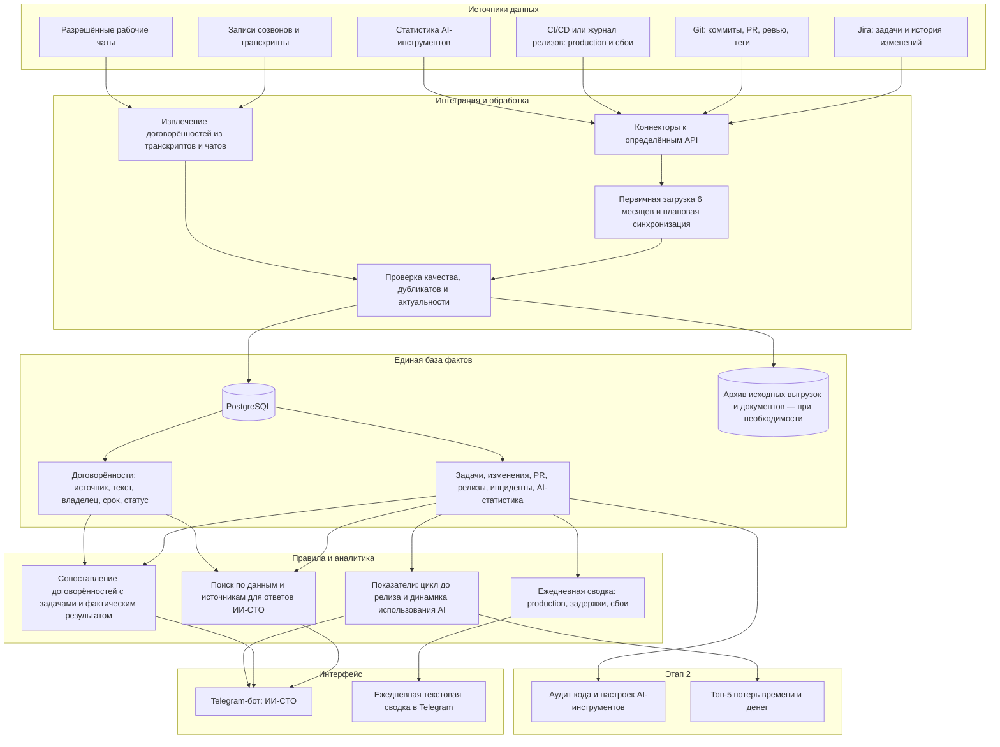

# Концепция «ИИ-штаб разработки» — адаптация под ТЗ директора

## 1. Назначение документа

Документ описывает предлагаемую техническую реализацию исходного ТЗ директора на создание «ИИ-штаба разработки» и ИИ-CTO. Это концепция решения, которую можно использовать для согласования объёма, архитектуры и последовательности внедрения.

**Главная цель:** обеспечить прозрачную картину разработки на основе данных рабочих систем, дать команде и руководству возможность задавать вопросы обычным языком и сопоставлять договорённости с фактическими результатами.

**Ключевой принцип директора:** важнее всего то, что вышло в production и работает. Количество задач, коммитов или обращений к AI само по себе не доказывает результат.

## 2. Требования директора и реализация

| Требование из ТЗ | Предлагаемая реализация | Проверяемый результат |
|---|---|---|
| Подключить Jira, Git и статистику AI-инструментов | Коннекторы к определённым API; первичная загрузка истории за 6 месяцев и дальнейшая синхронизация | История доступна в единой базе; ошибки и пропуски видны |
| Ежедневная сводка в Telegram | Планировщик формирует короткий текстовый отчёт по подтверждённым данным | Сводка публикуется автоматически и отвечает на вопросы: что вышло, что задержалось, были ли сбои |
| Запустить ИИ-CTO | Telegram-бот с поиском по задачам, коммитам, PR, релизам и отчётам | На вопрос «Что команда сделала за неделю?» бот отвечает со ссылками на источники и обозначением периода |
| Подключить записи созвонов и рабочие чаты | Импорт доступных записей/транскриптов и разрешённых сообщений; извлечение договорённостей | Договорённости сохраняются с источником, сроком и ответственным, если они известны |
| Сверять договорённости с фактическим выполнением | Связать договорённости с задачами, PR, релизами и другими подтверждениями | Видны выполненные, просроченные, открытые и требующие проверки договорённости |
| Измерить использование AI командами | Собирать доступную статистику AI-инструментов и связать её с командами/периодами в допустимых пределах | Можно анализировать динамику использования AI; выводы не строятся только на активности |
| Этап 2: аудит кода и AI-инструментов | Отдельный процесс анализа качества кода, конфигураций и практик использования AI | Подготовлен отчёт по результатам аудита и рекомендациям |
| Этап 2: измерить цикл от идеи до релиза | Определить события начала и завершения цикла на основании источников истины | Рассчитан цикл доставки и его изменения по периодам |
| Этап 2: найти топ-5 потерь времени и денег | Сопоставить задержки, повторную работу, дефекты, ожидания и доступные затраты | Подготовлен обоснованный список пяти наиболее существенных потерь |

## 3. Границы проекта и допущения

### 3.1. Входит в проект

- Интеграция с уже определёнными API Jira, Git и источников статистики AI-инструментов.
- Загрузка исторических данных за шесть месяцев, если API и права доступа позволяют это сделать.
- Постоянная синхронизация данных после первичной загрузки.
- Ежедневные короткие текстовые сводки в Telegram без перегруза метриками.
- ИИ-CTO для вопросов о задачах, командах, релизах и фактическом результате.
- Подключение разрешённых записей созвонов, транскриптов и рабочих чатов.
- Извлечение и хранение договорённостей и сопоставление с фактическим выполнением.
- Этап 2: аудит кода и AI-инструментов, анализ цикла до релиза и поиск потерь.

### 3.2. Не является обязательной частью первой версии

- Обучение собственной большой языковой модели с нуля.
- Автоматическое принятие управленческих решений без проверки человеком.
- Сбор всей корпоративной переписки без согласования доступа и цели обработки.
- Внедрение отдельной векторной базы, ClickHouse, RabbitMQ и микросервисов без подтверждённой потребности.
- Сложное прогнозирование до появления качественной истории и критериев проверки точности.
- Веб-дашборды как обязательный интерфейс первой версии: в ТЗ основной канал сводок и общения — Telegram.

### 3.3. Допущения, которые требуется подтвердить

| Вопрос | Что проверить |
|---|---|
| История за 6 месяцев | Доступна ли через определённые API, включая историю изменений, PR, релизов и AI-статистику |
| Факт выхода в production | Какая система считается источником истины: CI/CD, Git, система релизов или иной журнал деплоев |
| AI-статистика | Какие инструменты используются, какие данные доступны и что именно считается использованием AI |
| Созвоны | Доступны ли записи или транскрипты; разрешены ли их обработка и хранение |
| Рабочие чаты | Какие чаты и сообщения разрешено обрабатывать, кто имеет доступ к результатам |
| Договорённости | Как определять владельца, срок и критерий выполнения, если они не сформулированы явно |
| AI-модель | Допустима ли внешняя модель или требуется локальное размещение; какие данные можно передавать |
| Оценка эффекта | Какие показатели директор считает значимыми и какие данные нужны для сравнения «до/после» |

## 4. Предлагаемая архитектура

### Принципы архитектуры

1. **Источники данных — системы разработки, а не ручные отчёты.** Ручные статусы не должны заменять Jira, Git, CI/CD и доступную статистику инструментов.
2. **Числа рассчитывает код, AI объясняет результаты.** Сводка не должна просить языковую модель самостоятельно придумывать KPI или определять факт релиза без подтверждающих данных.
3. **Каждый важный вывод должен быть проверяемым.** Для ответов и договорённостей сохраняются ссылка на источник, дата и статус достоверности.
4. **Одна база фактов.** Telegram — интерфейс, а не хранилище истории.
5. **Минимум инфраструктуры на старте.** PostgreSQL и один backend; дополнительные компоненты добавляются только по необходимости.

## 5. MVP и целевая версия

| Область | MVP / первый рабочий контур | Целевая версия после проверки |
|---|---|---|
| Источники | Jira, Git, статистика AI-инструментов | Дополнительные источники релизов, CI/CD, созвонов и рабочих чатов в рамках ТЗ |
| Исторические данные | Первичная загрузка 6 месяцев, если доступна | Регулярное обновление, повторная загрузка и контроль полноты истории |
| Хранилище | PostgreSQL | PostgreSQL плюс архив файлов/исходных выгрузок, если требуется воспроизводимость обработки |
| Backend | Один сервис с отдельными модулями интеграции, отчётов и AI | Разделение компонентов только при росте нагрузки или требований к поддержке |
| Telegram | Один бот и ежедневная сводка | ИИ-CTO с вопросами по командам, задачам, релизам, договорённостям и динамике |
| AI | Готовая модель с доступом к проверенным данным | Поиск по документам и истории (RAG), тестирование качества и контроль доступа |
| Договорённости | После подключения транскриптов: реестр с источником, сроком, владельцем и статусом | Автоматическое сопоставление с задачами, PR и релизами с очередью на ручную проверку неоднозначных случаев |
| Метрики | Минимальный набор, необходимый для ежедневной сводки и приёмки | Цикл от идеи до релиза, динамика до/после AI, потери времени и денег |
| Дополнительные хранилища | Не требуются без обоснования | Векторный поиск или аналитическая БД только при реальной потребности |

**Важно:** по исходному ТЗ записи созвонов и рабочие чаты входят в этап 1. Поэтому их интеграцию следует включить в план первого этапа, даже если запускать её поэтапно после базовых коннекторов. Не следует представлять весь этап 1 как пилот только на одном источнике, если это не согласовано отдельно с директором.

## 6. Логика ежедневной сводки

Сводка должна быть короткой, текстовой и формироваться автоматически. Предлагаемый формат:

> **ИИ-штаб разработки — сводка за [дата]**
>
> **В production:** [релизы/изменения, подтверждённые источником деплоя].
>
> **Задержки:** [задачи или релизы, вышедшие за согласованный срок, причина — если подтверждена].
>
> **Сбои:** [инциденты и статус восстановления по доступным данным].
>
> **Договорённости:** [выполнено / просрочено / ожидает подтверждения].
>
> **AI:** [доступная статистика использования; без вывода об эффективности только по числу запросов].
>
> Данные актуальны на [время]. Источники: [ссылки]. Не удалось получить данные: [если есть].

Точные поля и пороги задержек необходимо согласовать с директором и владельцами источников. Если достоверного источника production-деплоев или инцидентов пока нет, сводка должна явно отмечать это ограничение.

## 7. ИИ-CTO: поведение и ограничения

### Примеры вопросов

- «Что команда сделала за неделю?»
- «Что вышло в production и где подтверждение?»
- «Какие релизы задерживаются и почему?»
- «Какие договорённости с прошлых созвонов ещё не выполнены?»
- «Какие команды используют AI-инструменты и как меняется использование?»
- «Как изменился цикл от идеи до релиза?» — после появления согласованной методики и достаточных данных.

### Требования к ответам

- Указывать период и время последнего обновления данных.
- По возможности давать ссылки на задачи, PR, релизы, инциденты или протоколы встреч.
- Различать факт, вывод и гипотезу.
- Сообщать, если источник недоступен, данные неполные или договорённость не удалось однозначно сопоставить с результатом.
- Проверять права пользователя до выдачи информации.
- Не считать коммиты, закрытые задачи или AI-запросы самостоятельным доказательством продуктивности.

Для первой версии не требуется обучение собственной модели. Практичнее использовать готовую языковую модель и давать ей контролируемый доступ к актуальным данным и поиску по истории. Fine-tuning можно рассматривать позднее для конкретной задачи, если будут подготовлены примеры и измеримые критерии качества.

## 8. Реестр договорённостей

Для каждой извлечённой договорённости рекомендуется хранить:

- уникальный ID;
- исходный текст и нормализованную формулировку;
- ссылку на сообщение, запись или транскрипт;
- дату встречи/обсуждения;
- ответственного — только если его можно определить из источника;
- срок — только если он был указан или согласован;
- связанную задачу, PR или релиз;
- статус: новая, подтверждена, в работе, выполнена, просрочена, требует проверки;
- подтверждение фактического выполнения;
- отметку уверенности извлечения и необходимость ручной проверки.

AI может предложить связь между договорённостью и задачей, но неоднозначные совпадения должны оставаться в статусе «требует проверки», а не автоматически отмечаться выполненными.

## 9. Этапы внедрения по ТЗ директора

### Этап 1. ИИ-штаб разработки

**1. Интеграции и история**
- Подключить Jira, Git и статистику AI-инструментов через определённые API.
- Загрузить историю за 6 месяцев, если она доступна через API и разрешена к обработке.
- Настроить регулярное обновление, обработку дубликатов, журнал ошибок и контроль актуальности.

**2. Ежедневная сводка Telegram**
- Согласовать источник истины для факта выхода в production, задержек и сбоев.
- Настроить ежедневную автоматическую публикацию короткой текстовой сводки.
- Добавить ссылки на подтверждающие источники и отметку о неполных данных.

**3. ИИ-CTO**
- Реализовать ответы на вопросы о задачах, командах и релизах.
- Добавить поиск по сохранённым данным и ссылки на первоисточники.
- Проверить ответы на наборе согласованных контрольных вопросов.

**4. Созвоны, рабочие чаты и договорённости**
- Подключить разрешённые записи, транскрипты и рабочие чаты.
- Сохранять извлечённые договорённости в единой базе.
- Сопоставлять договорённости с задачами и фактическими результатами.
- Предусмотреть ручную проверку неоднозначных случаев.

**Приёмка этапа 1 по ТЗ директора**
- Система отвечает на вопрос «Что команда сделала за неделю?» на основе рабочих систем.
- Команды используют ИИ-CTO для вопросов по задачам и релизам.
- Можно оценить динамику до и после внедрения AI при наличии сопоставимых исходных данных.
- Ежедневная сводка формируется без ручной подготовки.
- Источники, пробелы в данных и ошибки интеграций видимы ответственным.

### Этап 2. Аудит и эффективность

- Провести аудит кода и настроек AI-инструментов.
- Измерить цикл от идеи до production-релиза по согласованным определениям начала и конца.
- Выявить и обосновать топ-5 потерь времени и денег.
- Сформировать рекомендации и, по возможности, оценку ожидаемого эффекта.

## 10. Метрики результата и приёмки

Целевые числовые значения следует согласовать после проверки источников и исходного состояния. На старте важно зафиксировать методику и проверить воспроизводимость.

| Область | Метрика / проверка | Источник |
|---|---|---|
| Интеграции | Полнота и актуальность загруженных данных; число ошибок синхронизации | API Jira, Git, AI-инструментов и журнал интеграций |
| История | Успешность загрузки доступной истории за 6 месяцев | Источники и журнал загрузки |
| Production | Число и перечень подтверждённых релизов за период | CI/CD или согласованный источник релизов |
| Сводка | Ежедневная автоматическая публикация; отсутствие неподтверждённых фактов | Журнал задач и контрольная проверка отчётов |
| ИИ-CTO | Доля ответов, подтверждённых источниками; корректность ответов на контрольные вопросы | Тестовый набор и экспертная проверка |
| Договорённости | Доля записей со ссылкой на источник; доля сопоставленных и проверенных результатов | Реестр договорённостей и рабочие системы |
| Использование AI | Доступная динамика использования по командам и периодам | Статистика AI-инструментов |
| Эффективность | Изменение цикла от идеи до релиза и иных согласованных показателей | Jira, Git, CI/CD; методика этапа 2 |
| Потери | Пять наиболее значимых потерь с подтверждающими данными и методикой оценки | Совокупность источников и анализ этапа 2 |

**Оговорка для оценки «до/после»:** рост числа AI-запросов не доказывает рост производительности. Сравнение должно учитывать период, состав команды, тип задач, качество результата и возможные внешние факторы. Если исторических данных для конкретного показателя нет, это нужно обозначить, а не восстанавливать предположениями.

## 11. Минимальные требования безопасности и эксплуатации

- Использовать сервисные аккаунты с минимально необходимыми правами.
- Проверять доступ пользователя перед ответом ИИ-CTO.
- Не передавать внешней модели данные, запрещённые корпоративной политикой.
- Согласовать обработку записей встреч и сообщений рабочих чатов.
- Хранить токены API и Telegram вне исходного кода.
- Вести журналы синхронизации, ошибок и административных действий.
- Настроить резервное копирование и проверку восстановления базы.
- Определить сроки хранения исходных записей, транскриптов и извлечённых договорённостей.
- Разделять подтверждённые факты и AI-выводы; предусмотреть исправление ошибочных результатов.

## 12. Рекомендуемый стартовый технологический стек

| Компонент | Рекомендация для старта | Примечание |
|---|---|---|
| Backend | Python + FastAPI либо существующий стандарт компании | Один сервис с логически разделёнными модулями |
| Интеграции | Коннекторы к уже определённым API | Конкретные методы, права и лимиты подтвердить в тестовой среде |
| Хранилище | PostgreSQL | История, нормализованные данные, отчёты и договорённости |
| Архив | S3-совместимое хранилище — при необходимости | Для исходных файлов, транскриптов и повторной обработки |
| Планировщик | Cron или планировщик фоновых задач | Для синхронизации и ежедневной сводки на старте |
| Telegram | Telegram Bot API | Интерфейс вопросов и публикации сводки |
| AI | Готовая модель с контролируемым поиском по данным | Собственное обучение не является требованием ТЗ |
| Поиск по документам | Сначала PostgreSQL/полнотекстовый поиск; RAG по мере необходимости | Векторная БД не обязательна с первого дня |
| Наблюдаемость | Логи, статусы заданий, уведомления об ошибках | Важны контроль полноты данных и своевременности отчётов |

## 13. Решения, которые нужно согласовать перед стартом

1. Кто владелец проекта и кто принимает результат каждого этапа.
2. Какие именно API уже определены и какие доступы готовы для тестирования.
3. Какая система подтверждает выход в production и сбои.
4. Какие AI-инструменты используются и какая статистика доступна.
5. Какие источники созвонов и чатов разрешено подключить на этапе 1.
6. Где и как размещать AI-модель; какие категории данных разрешено передавать ей.
7. Как определить «динамику до и после AI» и цикл от идеи до релиза.
8. Какие целевые показатели, сроки и бюджет используются для приёмки.

## 14. Итоговая рекомендация

Предлагаемая архитектура должна строиться вокруг четырёх функций исходного ТЗ:

1. **Автоматическая сводка по реальным результатам разработки**, прежде всего подтверждённым production-релизам, задержкам и сбоям.
2. **ИИ-CTO**, который отвечает на вопросы по задачам, командам и релизам с опорой на источники.
3. **Единый реестр договорённостей**, извлечённых из разрешённых созвонов и рабочих чатов, с сопоставлением с фактическим выполнением.
4. **Измерение влияния AI на процесс разработки**, включая аудит, цикл от идеи до релиза и анализ потерь на этапе 2.

Для реализации не требуется начинать с большой платформы микросервисов или обучения собственной модели. Разумный путь — реализовать необходимые интеграции и историю, затем ежедневную сводку и ИИ-CTO, подключить обработку договорённостей в рамках этапа 1 и перейти к аудиту и оценке эффективности на этапе 2. При этом объём этапа 1 сохраняет все требования директора; поэтапность относится к порядку запуска компонентов, а не к исключению требований из ТЗ.
